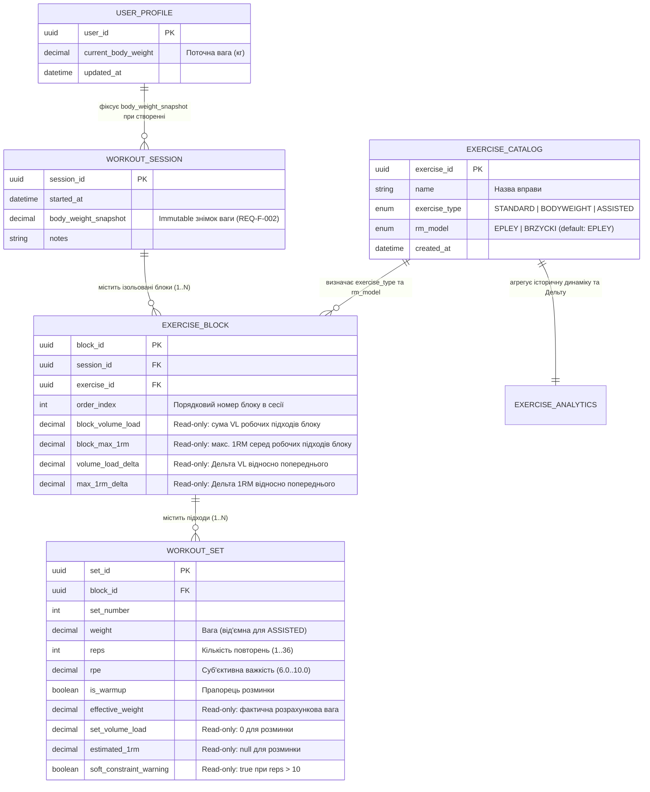

# Проєктування контракту REST API (`docs/api-design.md`)

**Проєкт:** Workout Volume & Progressive Overload Tracker  
**Версія API:** `v1` (`/api/v1`)  
**Статус документа:** Approved (API-GATE Passed)  
**Джерело істини (SSoT):** `spec/srs.tex`, `spec/srs-addendum.md`, `docs/traceability.md`, `docs/risk-register.md`

---

## 1. Аналіз функціональних вимог SRS та сутностей предметної області

У межах архітектури клієнт-сервер (Mobile-First клієнт + REST API бекенд) функціональні вимоги `REQ-F-001` – `REQ-F-021` розподіляються на дві категорії:
1. **Клієнтські операції (Explicit Client-Triggered Operations):** дії, які безпосередньо ініціюються HTTP-запитами від клієнтського застосунку.
2. **Серверні обчислення (Implicit Server-Computed Logic):** інваріанти, математичні формули та агрегації, які виконуються виключно на стороні сервера під час обробки запитів і повертаються клієнту в read-only полях JSON-відповідей.

### 1.1. Матриця розподілу вимог (`REQ-F-001` – `REQ-F-021`)

| ID вимоги | Опис вимоги у SRS / SRS Addendum | Тип у REST API | Механізм реалізації в контракті API |
| :--- | :--- | :--- | :--- |
| **REQ-F-001** | Створення нової тренувальної сесії | **Викликається клієнтом** | `POST /api/v1/sessions` створює новий ресурс сесії. |
| **REQ-F-002** | Автоматична фіксація маси тіла (`body_weight_snapshot`) при створенні сесії | **Обчислюється сервером** | Під час `POST /api/v1/sessions` сервер автоматично зчитує поточну вагу з профілю користувача та записує її в незмінне (immutable) поле `body_weight_snapshot` сесії. |
| **REQ-F-003** | Додавання вправ до створеної сесії | **Викликається клієнтом** | `POST /api/v1/sessions/{sessionId}/blocks` додає ізольований блок вправи до сесії. |
| **REQ-F-004** | Фіксація підходів (вага, повторення, RPE 6.0–10.0) | **Викликається клієнтом** | `POST /api/v1/sessions/{sessionId}/blocks/{blockId}/sets` передає `weight`, `reps`, `rpe`. |
| **REQ-F-005** | Позначка підходу як «Розминочний» (`is_warmup`) | **Викликається клієнтом** | Булевий атрибут `is_warmup` передається в тілі запиту при створенні/оновленні підходу. |
| **REQ-F-006** | Автоматичний розрахунок Volume Load для підходу та суворо для конкретного блоку вправи | **Обчислюється сервером** | Сервер синхронно обчислює `set_volume_load` для підходу та перераховує агрегат `block_volume_load` виключно в межах даного `blockId`. |
| **REQ-F-007** | Ігнорування розминочних підходів при розрахунку Volume Load | **Обчислюється сервером** | Якщо `is_warmup == true`, сервер примусово встановлює `set_volume_load = 0.0` і не додає підхід до `block_volume_load`. |
| **REQ-F-008** | Формула Volume Load для стандартних вправ: $W \times R$ | **Обчислюється сервером** | Для вправ із `exercise_type == "STANDARD"` сервер застосовує формулу `weight * reps`. |
| **REQ-F-009** | Формула Volume Load для вправ із власною вагою: $(BW_{snapshot} + W_{added}) \times R$ | **Обчислюється сервером** | Для `BODYWEIGHT` та `ASSISTED` сервер бере `body_weight_snapshot` поточної сесії та обчислює `(body_weight_snapshot + weight) * reps`. |
| **REQ-F-010** | Підтримка від'ємного значення «Додаткової ваги» для вправ із компенсацією | **Клієнт (ввід) + Сервер (розрахунок)** | Клієнт передає від'ємний `weight` (напр., `-20.0`) для вправи типу `ASSISTED`; сервер валідує знак і зменшує ефективне навантаження. |
| **REQ-F-011** | Автоматичне обчислення 1RM для кожного робочого підходу | **Обчислюється сервером** | Для кожного підходу з `is_warmup == false` сервер обчислює `estimated_1rm` (для розминочних повертає `null`). |
| **REQ-F-012** | Вибір математичної моделі 1RM (`Epley` або `Brzycki`) в налаштуваннях вправи | **Викликається клієнтом** | `PATCH /api/v1/exercises/{exerciseId}` (та `POST /api/v1/exercises`) дозволяє задати поле `rm_model` (`"EPLEY"` або `"BRZYCKI"`). |
| **REQ-F-013** | Встановлення формули `Epley` за замовчуванням при створенні нової вправи | **Обчислюється сервером** | Якщо в `POST /api/v1/exercises` поле `rm_model` не передано, сервер автоматично встановлює `"EPLEY"`. |
| **REQ-F-014** | Розрахунок 1RM при `reps > 10` із попередженням (`Soft Constraint`) | **Обчислюється сервером** | При `reps > 10` сервер повертає розраховане число `estimated_1rm` та встановлює прапорець `soft_constraint_warning = true` (та код причини). |
| **REQ-F-015** | Обчислення Дельти сумарного Volume Load відносно останнього хронологічного виконання вправи | **Обчислюється сервером** | Сервер знаходить останній попередній блок цієї ж вправи та повертає `volume_load_delta` в об'єкті блоку та аналітики. |
| **REQ-F-016** | Обчислення Дельти максимального 1RM відносно останнього хронологічного виконання вправи | **Обчислюється сервером** | Сервер порівнює `block_max_1rm` поточного блоку з попереднім хронологічним виконанням та повертає `max_1rm_delta`. |
| **REQ-F-017** | Візуальний дашборд для кожної вправи з динамікою Volume Load та max 1RM | **Викликається клієнтом (GET) + Серверна агрегація** | `GET /api/v1/exercises/{exerciseId}/analytics` повертає впорядкований часовий ряд (`data_points`) та поточні дельти для побудови графіка. |
| **REQ-F-018** | Відсутність розрахунку Дельти, якщо попередніх записів виконання вправи немає | **Обчислюється сервером** | Якщо історія виконання вправи відсутня, сервер повертає `volume_load_delta: null`, `max_1rm_delta: null` та `has_previous_baseline: false`. |
| **REQ-F-019** | Управління профілем користувача та поточною масою тіла (`30.0–300.0` кг) із збереженням історичної незмінності `body_weight_snapshot` (`spec/srs-addendum.md`) | **Викликається клієнтом (GET/PUT) + Серверний інваріант** | `GET /api/v1/profile` та `PUT /api/v1/profile` оновлюють `current_body_weight` без модифікації `body_weight_snapshot` у раніше створених сесіях. |
| **REQ-F-020** | Управління каталогом (довідником) силових вправ (`STANDARD`, `BODYWEIGHT`, `ASSISTED`) (`spec/srs-addendum.md`) | **Викликається клієнтом** | `POST /api/v1/exercises`, `GET /api/v1/exercises` та `GET /api/v1/exercises/{exerciseId}` забезпечують реєстрацію та читання довідника вправ. |
| **REQ-F-021** | Використання ефективного обтяження $W_{eff}$ у моделях 1RM та поблочна хронологічна база порівняння Дельти (`spec/srs-addendum.md`) | **Обчислюється сервером** | Сервер підставляє $W_{eff} = BW_{snapshot} + W_{added}$ у формули Epley/Brzycki для `BODYWEIGHT`/`ASSISTED` та визначає Дельту відносно попереднього хронологічного блоку `ExerciseBlock`. |

---

## 2. Основні REST-ресурси предметної області та їхні зв'язки

Для суворого виконання вимоги **`REQ-F-006`** та нейтралізації ризику **`RSK-09`** (помилкова агрегація дубльованих вправ у сесії) модель ресурсів чітко розмежовує:
* **`Exercise` (Сутність довідника вправ)** — метадані вправи (назва, тип, математична модель 1RM).
* **`ExerciseBlock` (Ізольований блок вправи в сесії)** — конкретний екземпляр виконання вправи в межах тренувальної сесії. Якщо атлет виконує «Присідання» на початку тренування і повторно в кінці тренування, у сесії створюються **два окремі ресурси `ExerciseBlock`** з унікальними `block_id`. Їхній `block_volume_load` та `block_max_1rm` розраховуються повністю незалежно.

### 2.1. Діаграма ієрархії та зв'язків ресурсів



---

## 3. Зведена таблиця URI ресурсів та HTTP-методів

Базовий префікс API: `/api/v1`  
Формат обміну даними: `application/json; charset=utf-8`

| Група ресурсів | HTTP Метод | URI Шлях | Operation ID | Короткий опис операції | Пов'язані вимоги SRS |
| :--- | :---: | :--- | :--- | :--- | :--- |
| **Profile** | `GET` | `/api/v1/profile` | `getUserProfile` | Отримання профілю користувача (поточна маса тіла) | REQ-F-002, REQ-F-019 |
| **Profile** | `PUT` | `/api/v1/profile` | `updateUserProfile` | Оновлення поточної маси тіла користувача | REQ-F-019, BDD-001 |
| **Exercises** | `POST` | `/api/v1/exercises` | `createExercise` | Створення нової вправи в довіднику (`EPLEY` за замовчуванням) | REQ-F-012, REQ-F-013, REQ-F-020 |
| **Exercises** | `GET` | `/api/v1/exercises` | `listExercises` | Отримання списку всіх вправ довідника | REQ-F-020 |
| **Exercises** | `GET` | `/api/v1/exercises/{exerciseId}` | `getExerciseById` | Отримання деталей та конфігурації конкретної вправи | REQ-F-012, REQ-F-020 |
| **Exercises** | `PATCH` | `/api/v1/exercises/{exerciseId}` | `updateExerciseModel` | Зміна налаштувань вправи (зокрема формули `rm_model`) | REQ-F-012, BDD-006 |
| **Sessions** | `POST` | `/api/v1/sessions` | `createSession` | Створення тренувальної сесії та фіксація `body_weight_snapshot` | REQ-F-001, REQ-F-002, BDD-001 |
| **Sessions** | `GET` | `/api/v1/sessions` | `listSessions` | Отримання списку тренувальних сесій | REQ-F-001 |
| **Sessions** | `GET` | `/api/v1/sessions/{sessionId}` | `getSessionById` | Отримання детального стану сесії з усіма блоками та підходами | REQ-F-001 – REQ-F-016, BDD-001, BDD-003, BDD-006 |
| **Exercise Blocks** | `POST` | `/api/v1/sessions/{sessionId}/blocks` | `createExerciseBlock` | Додавання нового ізольованого блоку вправи у сесію | REQ-F-003, REQ-F-006, RSK-09 |
| **Exercise Blocks** | `GET` | `/api/v1/sessions/{sessionId}/blocks/{blockId}` | `getExerciseBlockById` | Отримання даних конкретного блоку вправи, його об'єму та Дельти | REQ-F-006, REQ-F-015, REQ-F-016, REQ-F-021 |
| **Workout Sets** | `POST` | `/api/v1/sessions/{sessionId}/blocks/{blockId}/sets` | `createWorkoutSet` | Запис (auto-save) підходу з миттєвим обчисленням метрик | REQ-F-004 – REQ-F-011, REQ-F-014, REQ-F-021, REQ-NF-001, REQ-NF-003 |
| **Workout Sets** | `DELETE` | `/api/v1/sessions/{sessionId}/blocks/{blockId}/sets/{setId}` | `deleteWorkoutSet` | Видалення помилково введеного підходу з перерахунком блоку | REQ-F-004, REQ-F-006 |
| **Analytics** | `GET` | `/api/v1/exercises/{exerciseId}/analytics` | `getExerciseAnalytics` | Отримання даних дашборду (часовий ряд Volume Load, 1RM та Дельти) | REQ-F-015 – REQ-F-018, REQ-F-021, BDD-005, BDD-007 |

---

## 4. Конвенція кодів стану HTTP та обробки помилок

Для чіткої верифікації автотестами (`REQ-NF-010`) та захисту від ризиків `RSK-02` (математичні аномалії) і `RSK-07` (помилки знаку компенсації) впроваджується суворе розмежування кодів стану HTTP:

* **`200 OK`** — Успішне виконання запитів читання (`GET`) або модифікації існуючого ресурсу (`PUT`, `PATCH`, `DELETE`).
* **`201 Created`** — Успішне створення нового ресурсу (`POST` для вправи, сесії, блоку вправи або підходу). Повертає створений об'єкт разом з усіма обчисленими сервером полями.
* **`400 Bad Request` (Синтаксична / структурна помилка запиту):**
  * Невалідний синтаксис JSON.
  * Відсутність обов'язкового поля (наприклад, не передано `reps` або `rpe`).
  * Невідповідність примітивних типів даних (наприклад, передано рядок `"ten"` замість цілого числа `10` або невалідний формат UUID у path-параметрі).
  * Невідоме значення перерахування (наприклад, `rm_model: "UNKNOWN_FORMULA"`).
* **`404 Not Found` (Ресурс не знайдено):**
  * Звернення за неіснуючим ідентифікатором `exerciseId`, `sessionId`, `blockId` або `setId`.
* **`422 Unprocessable Entity` (Порушення доменних бізнес-правил SRS):**
  Синтаксично коректний JSON, значення якого порушують інваріанти предметної області силового трекера:
  1. `ERR_RPE_OUT_OF_RANGE` (`REQ-F-004`): значення `rpe` менше `6.0` або більше `10.0`.
  2. `ERR_INVALID_REPS_COUNT` (`REQ-F-004`, `RSK-02`): значення `reps <= 0`.
  3. `ERR_BRZYCKI_MATHEMATICAL_LIMIT` (`REQ-F-011`, `RSK-02`): значення `reps >= 37` для робочого підходу (`is_warmup == false`), оскільки у формулі Brzycki $W \times \frac{36}{37 - R}$ при $R = 37$ виникає ділення на нуль, а при $R > 37$ — від'ємний 1RM.
  4. `ERR_NEGATIVE_WEIGHT_NOT_ALLOWED` (`REQ-F-008`, `REQ-F-009`, `REQ-F-010`, `RSK-07`): порушення правила знаку ваги залежно від біомеханічного типу вправи:
     * для `STANDARD`: `weight > 0` (вага обтяження має бути суворо більшою за нуль; при `weight <= 0` повертається `422`);
     * для `BODYWEIGHT`: `weight >= 0` (`0` — власна вага без додаткового обтяження, `> 0` — додаткова вага на поясі; при `weight < 0` повертається `422`);
     * для `ASSISTED`: `weight <= 0` за обов'язкової умови `body_weight_snapshot + weight > 0`.
  5. `ERR_POSITIVE_WEIGHT_IN_ASSISTED` (`REQ-F-010`, `RSK-07`): передано додатну вагу `weight > 0` для вправи з компенсацією (`ASSISTED`), де очікується значення `<= 0`.
  6. `ERR_NON_POSITIVE_EFFECTIVE_LOAD` (`REQ-F-009`, `REQ-F-010`, `RSK-07`): для вправи типу `ASSISTED` сума `body_weight_snapshot + weight <= 0` (наприклад, вага тіла 80 кг, а противага -85 кг), що робить фізичну роботу неможливою.
  7. `ERR_INVALID_BODY_WEIGHT` (`REQ-F-002`, `REQ-F-019`): спроба встановити масу тіла в профілі поза межами допустимого діапазону `[30.0, 300.0]` кг (`< 30.0` або `> 300.0` кг).

### Єдиний формат тіла помилки (`400`, `404`, `422`)

```json
{
  "error": {
    "code": "ERR_RPE_OUT_OF_RANGE",
    "http_status": 422,
    "message": "Показник RPE повинен знаходитися в діапазоні від 6.0 до 10.0 згідно з REQ-F-004.",
    "details": {
      "field": "rpe",
      "rejected_value": 5.5,
      "allowed_min": 6.0,
      "allowed_max": 10.0
    },
    "trace_id": "trc-9f8b7a6c-2026"
  }
}
```

---

## 5. Детальна специфікація операцій REST API

---

### 5.1. Профіль користувача (`Profile`)

#### `GET /api/v1/profile` — Отримання профілю користувача
Повертає глобальні налаштування атлета, включно з поточною масою тіла.

* **Параметри запиту:** відсутні.
* **Коди відповіді:** `200 OK`.

**Response Body (`200 OK`):**
```json
{
  "user_id": "018f3a10-0000-7000-8000-000000000001",
  "current_body_weight": 80.0,
  "unit": "kg",
  "updated_at": "2026-09-01T08:30:00Z"
}
```

---

#### `PUT /api/v1/profile` — Оновлення поточної маси тіла в профілі
Оновлює глобальне значення маси тіла користувача. Згідно з `REQ-F-002` та `BDD-001`, ця операція змінює лише майбутні снапшоти при створенні нових сесій і **не мутує** `body_weight_snapshot` у вже створених сесіях.

* **Параметри запиту:** відсутні.
* **Коди відповіді:**
  * `200 OK` — Масу тіла успішно оновлено.
  * `400 Bad Request` — Відсутнє поле `current_body_weight` або невірний тип даних.
  * `422 Unprocessable Entity` — Значення `current_body_weight` поза діапазоном `[30.0, 300.0]` кг (`ERR_INVALID_BODY_WEIGHT`, `REQ-F-019`).

**Request Body:**
```json
{
  "current_body_weight": 85.0
}
```

**Response Body (`200 OK`):**
```json
{
  "user_id": "018f3a10-0000-7000-8000-000000000001",
  "current_body_weight": 85.0,
  "unit": "kg",
  "updated_at": "2026-10-01T10:15:00Z"
}
```

---

### 5.2. Довідник вправ (`Exercises`)

#### `POST /api/v1/exercises` — Створення нової вправи в довіднику
Реєструє нову вправу із зазначенням її біомеханічного типу (`STANDARD`, `BODYWEIGHT`, `ASSISTED`). Згідно з `REQ-F-013`, якщо поле `rm_model` не передано у запиті, система автоматично встановлює `"EPLEY"`.

* **Параметри запиту:** відсутні.
* **Коди відповіді:**
  * `201 Created` — Вправу успішно створено.
  * `400 Bad Request` — Порожня назва `name` або невідоме значення `exercise_type` / `rm_model`.
  * `422 Unprocessable Entity` — Вправа з такою назвою вже існує в довіднику (`ERR_DUPLICATE_EXERCISE_NAME`).

**Request Body:**
```json
{
  "name": "Підтягування у гравітроні",
  "exercise_type": "ASSISTED"
}
```
*(Поле `rm_model` опціональне: `"EPLEY"` | `"BRZYCKI"`, за замовчуванням `"EPLEY"`).*

**Response Body (`201 Created`):**
```json
{
  "exercise_id": "ex-7701-4a2b-9c11-000000000002",
  "name": "Підтягування у гравітроні",
  "exercise_type": "ASSISTED",
  "rm_model": "EPLEY",
  "created_at": "2026-09-01T09:00:00Z"
}
```

---

#### `GET /api/v1/exercises` — Отримання списку вправ
* **Query-параметри (опціональні):**
  * `exercise_type` (string): фільтр за типом (`STANDARD`, `BODYWEIGHT`, `ASSISTED`).
* **Коди відповіді:** `200 OK`.

**Response Body (`200 OK`):**
```json
{
  "items": [
    {
      "exercise_id": "ex-7701-4a2b-9c11-000000000001",
      "name": "Присідання зі штангою",
      "exercise_type": "STANDARD",
      "rm_model": "EPLEY"
    },
    {
      "exercise_id": "ex-7701-4a2b-9c11-000000000002",
      "name": "Підтягування у гравітроні",
      "exercise_type": "ASSISTED",
      "rm_model": "EPLEY"
    }
  ],
  "total": 2
}
```

---

#### `GET /api/v1/exercises/{exerciseId}` — Отримання деталей та конфігурації конкретної вправи
Повертає повні метадані обраної вправи з довідника, включно з її біомеханічним типом та активною математичною моделлю розрахунку 1RM (`REQ-F-012`).

* **Path-параметри:**
  * `exerciseId` (UUID / string, required) — ідентифікатор вправи.
* **Коди відповіді:**
  * `200 OK` — Деталі вправи успішно повернуто.
  * `404 Not Found` — Вправу з вказаним `exerciseId` не знайдено.

**Response Body (`200 OK`):**
```json
{
  "exercise_id": "ex-7701-4a2b-9c11-000000000001",
  "name": "Присідання зі штангою",
  "exercise_type": "STANDARD",
  "rm_model": "EPLEY",
  "created_at": "2026-09-01T08:45:00Z",
  "updated_at": "2026-09-01T08:45:00Z"
}
```

---

#### `PATCH /api/v1/exercises/{exerciseId}` — Налаштування математичної моделі 1RM для вправи
Реалізує вимогу `REQ-F-012`: дозволяє користувачеві гранулярно змінити формулу розрахунку 1RM (`EPLEY` або `BRZYCKI`) на рівні конкретної вправи.

* **Path-параметри:**
  * `exerciseId` (UUID / string, required) — ідентифікатор вправи.
* **Коди відповіді:**
  * `200 OK` — Налаштування вправи оновлено.
  * `400 Bad Request` — Невалідне значення `rm_model` (дозволені лише `"EPLEY"` або `"BRZYCKI"`).
  * `404 Not Found` — Вправу з вказаним `exerciseId` не знайдено.

**Request Body:**
```json
{
  "rm_model": "BRZYCKI"
}
```

**Response Body (`200 OK`):**
```json
{
  "exercise_id": "ex-7701-4a2b-9c11-000000000001",
  "name": "Присідання зі штангою",
  "exercise_type": "STANDARD",
  "rm_model": "BRZYCKI",
  "updated_at": "2026-09-02T11:20:00Z"
}
```

---

### 5.3. Тренувальні сесії (`Workout Sessions`)

#### `POST /api/v1/sessions` — Створення нової тренувальної сесії
Реалізує `REQ-F-001` та `REQ-F-002`. Створює сесію та автоматично робить незмінний знімок маси тіла `body_weight_snapshot` із поточного стану `Profile`.

* **Параметри запиту:** відсутні.
* **Коди відповіді:**
  * `201 Created` — Сесію створено, `body_weight_snapshot` зафіксовано.
  * `400 Bad Request` — Невалідний формат дати `started_at`.
  * `422 Unprocessable Entity` — У профілі користувача не задана або некоректна маса тіла (`ERR_PROFILE_WEIGHT_MISSING`).

**Request Body:**
```json
{
  "started_at": "2026-09-15T17:00:00Z",
  "notes": "Важке силове тренування ніг та спини"
}
```
*(Поля `started_at` та `notes` опціональні; якщо `started_at` не передано, сервер фіксує поточний UTC-час).*

**Response Body (`201 Created`):**
```json
{
  "session_id": "ses-9001-2026-0915-000000000001",
  "started_at": "2026-09-15T17:00:00Z",
  "body_weight_snapshot": 80.0,
  "notes": "Важке силове тренування ніг та спини",
  "blocks": []
}
```

---

#### `GET /api/v1/sessions` — Отримання списку тренувальних сесій
Повертає хронологічний список проведених тренувальних сесій атлета із зафіксованими знімками маси тіла (`body_weight_snapshot`) та короткою статистикою блоків.

* **Query-параметри (опціональні):**
  * `limit` (int, default `20`) — кількість записів на сторінку.
  * `offset` (int, default `0`) — зміщення для пагінації.
* **Коди відповіді:** `200 OK`, `400 Bad Request` (некоректні параметри пагінації).

**Response Body (`200 OK`):**
```json
{
  "items": [
    {
      "session_id": "ses-9001-2026-0915-000000000001",
      "started_at": "2026-09-15T17:00:00Z",
      "body_weight_snapshot": 80.0,
      "notes": "Важке силове тренування ніг та спини",
      "blocks_count": 2
    },
    {
      "session_id": "ses-9001-2026-0908-000000000001",
      "started_at": "2026-09-08T18:00:00Z",
      "body_weight_snapshot": 80.0,
      "notes": "Базове тренування",
      "blocks_count": 1
    }
  ],
  "total": 2,
  "limit": 20,
  "offset": 0
}
```

---

#### `GET /api/v1/sessions/{sessionId}` — Отримання детальної інформації про сесію
Повертає тренувальну сесію з усіма доданими блоками вправ, підходами та автоматично розрахованими показниками Volume Load, 1RM і Дельти.

* **Path-параметри:**
  * `sessionId` (UUID / string, required) — ідентифікатор сесії.
* **Коди відповіді:**
  * `200 OK` — Дані сесії повернуто.
  * `404 Not Found` — Сесію не знайдено.

**Response Body (`200 OK`):**
```json
{
  "session_id": "ses-9001-2026-0915-000000000001",
  "started_at": "2026-09-15T17:00:00Z",
  "body_weight_snapshot": 80.0,
  "notes": "Важке силове тренування ніг та спини",
  "blocks": [
    {
      "block_id": "blk-1001-0001",
      "exercise_id": "ex-7701-4a2b-9c11-000000000001",
      "exercise_name": "Присідання зі штангою",
      "exercise_type": "STANDARD",
      "rm_model": "EPLEY",
      "order_index": 1,
      "block_volume_load": 500.0,
      "block_max_1rm": 116.66,
      "has_previous_baseline": true,
      "volume_load_delta": 50.0,
      "max_1rm_delta": 2.5,
      "sets": [
        {
          "set_id": "set-5001",
          "set_number": 1,
          "weight": 60.0,
          "effective_weight": 60.0,
          "reps": 10,
          "rpe": 6.5,
          "is_warmup": true,
          "set_volume_load": 0.0,
          "estimated_1rm": null,
          "soft_constraint_warning": false
        },
        {
          "set_id": "set-5002",
          "set_number": 2,
          "weight": 100.0,
          "effective_weight": 100.0,
          "reps": 5,
          "rpe": 8.5,
          "is_warmup": false,
          "set_volume_load": 500.0,
          "estimated_1rm": 116.66,
          "soft_constraint_warning": false
        }
      ]
    }
  ]
}
```

---

### 5.4. Блоки вправ у сесії (`Exercise Blocks`)

#### `POST /api/v1/sessions/{sessionId}/blocks` — Додавання блоку вправи до сесії
Реалізує `REQ-F-003` та `REQ-F-006` (ізоляція блоків). Якщо клієнт викликає цей метод двічі з однаковим `exercise_id`, створюються два незалежні ресурси `ExerciseBlock` з різними `block_id` та `order_index`.

* **Path-параметри:**
  * `sessionId` (string, required) — ідентифікатор сесії.
* **Коди відповіді:**
  * `201 Created` — Блок вправи створено в сесії.
  * `400 Bad Request` — Не передано `exercise_id`.
  * `404 Not Found` — Сесію `sessionId` або вправу `exercise_id` не знайдено.

**Request Body:**
```json
{
  "exercise_id": "ex-7701-4a2b-9c11-000000000002"
}
```

**Response Body (`201 Created`):**
```json
{
  "block_id": "blk-1001-0002",
  "session_id": "ses-9001-2026-0915-000000000001",
  "exercise_id": "ex-7701-4a2b-9c11-000000000002",
  "exercise_name": "Підтягування у гравітроні",
  "exercise_type": "ASSISTED",
  "rm_model": "EPLEY",
  "order_index": 2,
  "block_volume_load": 0.0,
  "block_max_1rm": null,
  "has_previous_baseline": false,
  "volume_load_delta": null,
  "max_1rm_delta": null,
  "sets": []
}
```

---

#### `GET /api/v1/sessions/{sessionId}/blocks/{blockId}` — Отримання блоку вправи та його метрик
Повертає актуальний стан конкретного ізольованого блоку вправи, його сумарний `block_volume_load` (`REQ-F-006`), максимальний 1RM (`BDD-006`) та розраховані Дельти відносно попереднього виконання цієї вправи (`REQ-F-015`, `REQ-F-016`, `REQ-F-018`).

* **Path-параметри:**
  * `sessionId` (string, required) — ідентифікатор сесії.
  * `blockId` (string, required) — ідентифікатор блоку вправи.
* **Коди відповіді:**
  * `200 OK` — Блок вправи та розрахункові метрики повернуто.
  * `404 Not Found` — Сесію або блок вправи не знайдено.

**Response Body (`200 OK`):**
```json
{
  "block_id": "blk-1001-0001",
  "session_id": "ses-9001-2026-0915-000000000001",
  "exercise_id": "ex-7701-4a2b-9c11-000000000001",
  "exercise_name": "Присідання зі штангою",
  "exercise_type": "STANDARD",
  "rm_model": "EPLEY",
  "order_index": 1,
  "block_volume_load": 500.0,
  "block_max_1rm": 116.66,
  "has_previous_baseline": true,
  "volume_load_delta": 50.0,
  "max_1rm_delta": 2.5,
  "sets": [
    {
      "set_id": "set-5001",
      "set_number": 1,
      "weight": 60.0,
      "effective_weight": 60.0,
      "reps": 10,
      "rpe": 6.5,
      "is_warmup": true,
      "set_volume_load": 0.0,
      "estimated_1rm": null,
      "soft_constraint_warning": false
    },
    {
      "set_id": "set-5002",
      "set_number": 2,
      "weight": 100.0,
      "effective_weight": 100.0,
      "reps": 5,
      "rpe": 8.5,
      "is_warmup": false,
      "set_volume_load": 500.0,
      "estimated_1rm": 116.66,
      "soft_constraint_warning": false
    }
  ]
}
```

---

### 5.5. Підходи (`Workout Sets`)

#### `POST /api/v1/sessions/{sessionId}/blocks/{blockId}/sets` — Фіксація підходу (Auto-Save)
Ключова операція трекера, що реалізує `REQ-F-004` – `REQ-F-011`, `REQ-F-014` та `REQ-NF-003`. Приймає параметри підходу, синхронно виконує всі математичні розрахунки (<100 мс згідно з `REQ-NF-001`) та повертає як створений підхід, так і оновлені агрегати батьківського блоку (`block_summary`).

* **Path-параметри:**
  * `sessionId` (string, required) — ідентифікатор сесії.
  * `blockId` (string, required) — ідентифікатор блоку вправи.
* **Коди відповіді:**
  * `201 Created` — Підхід збережено, метрики Volume Load, 1RM та Дельти обчислено.
  * `400 Bad Request` — Синтаксична помилка або відсутні обов'язкові поля (`weight`, `reps`, `rpe`).
  * `404 Not Found` — Сесію або блок вправи не знайдено.
  * `422 Unprocessable Entity` — Порушення доменних обмежень:
    * `rpe` поза межами `[6.0, 10.0]` (`REQ-F-004`);
    * `reps <= 0` або `reps >= 37` (`RSK-02`);
    * невідповідність знака `weight` типу вправи або `body_weight_snapshot + weight <= 0` (`REQ-F-010`, `RSK-07`).

**Приклад 1 — Стандартний робочий підхід із `reps > 10` (Сценарій `BDD-004` Soft Constraint):**

**Request Body:**
```json
{
  "weight": 100.0,
  "reps": 12,
  "rpe": 9.0,
  "is_warmup": false
}
```

**Response Body (`201 Created`):**
```json
{
  "set": {
    "set_id": "set-5003",
    "block_id": "blk-1001-0001",
    "set_number": 1,
    "weight": 100.0,
    "effective_weight": 100.0,
    "reps": 12,
    "rpe": 9.0,
    "is_warmup": false,
    "set_volume_load": 1200.0,
    "estimated_1rm": 140.0,
    "soft_constraint_warning": true,
    "warning_message": "Кількість повторень перевищує 10 (R=12). Розрахункове значення 1RM має знижену точність (REQ-F-014)."
  },
  "block_summary": {
    "block_id": "blk-1001-0001",
    "block_volume_load": 1200.0,
    "block_max_1rm": 140.0,
    "has_previous_baseline": true,
    "volume_load_delta": 100.0,
    "max_1rm_delta": 5.0
  }
}
```

**Приклад 2 — Вправа з компенсацією у гравітроні (Сценарій `BDD-002`, `body_weight_snapshot = 80.0`):**

**Request Body:**
```json
{
  "weight": -20.0,
  "reps": 10,
  "rpe": 8.0,
  "is_warmup": false
}
```

**Response Body (`201 Created`):**
```json
{
  "set": {
    "set_id": "set-5004",
    "block_id": "blk-1001-0002",
    "set_number": 1,
    "weight": -20.0,
    "effective_weight": 60.0,
    "reps": 10,
    "rpe": 8.0,
    "is_warmup": false,
    "set_volume_load": 600.0,
    "estimated_1rm": 80.0,
    "soft_constraint_warning": false,
    "warning_message": null
  },
  "block_summary": {
    "block_id": "blk-1001-0002",
    "block_volume_load": 600.0,
    "block_max_1rm": 80.0,
    "has_previous_baseline": false,
    "volume_load_delta": null,
    "max_1rm_delta": null
  }
}
```

---

#### `DELETE /api/v1/sessions/{sessionId}/blocks/{blockId}/sets/{setId}` — Видалення підходу з перерахунком блоку
Видаляє помилково зафіксований підхід із конкретного блоку вправи та синхронно перераховує агреговані метрики блоку (`block_volume_load`, `block_max_1rm`, `volume_load_delta`, `max_1rm_delta` згідно з `REQ-F-004` та `REQ-F-006`).

* **Path-параметри:**
  * `sessionId` (string, required) — ідентифікатор сесії.
  * `blockId` (string, required) — ідентифікатор блоку вправи.
  * `setId` (string, required) — ідентифікатор підходу, що видаляється.
* **Коди відповіді:**
  * `200 OK` — Підхід успішно видалено, повернено оновлене зведення блоку вправи (`block_summary`).
  * `404 Not Found` — Сесію, блок вправи або підхід з вказаним ідентифікатором не знайдено.

**Response Body (`200 OK`):**
```json
{
  "deleted_set_id": "set-5004",
  "block_summary": {
    "block_id": "blk-1001-0002",
    "block_volume_load": 0.0,
    "block_max_1rm": null,
    "has_previous_baseline": false,
    "volume_load_delta": null,
    "max_1rm_delta": null
  }
}
```

---

### 5.6. Аналітика та моніторинг прогресії (`Exercise Analytics Dashboard`)

#### `GET /api/v1/exercises/{exerciseId}/analytics` — Дані аналітичного дашборду вправи
Реалізує вимоги `REQ-F-015`, `REQ-F-016`, `REQ-F-017`, `REQ-F-018` та сценарії `BDD-005` і `BDD-007`. Повертає хронологічно впорядковані точки для рендерингу лінійного графіка динаміки Volume Load та максимального 1RM, а також підсумкову Дельту останнього виконання відносно передостаннього.

* **Path-параметри:**
  * `exerciseId` (string, required) — ідентифікатор вправи з довідника.
* **Query-параметри (опціональні):**
  * `from_date` (ISO 8601 date) — початок періоду вибірки.
  * `to_date` (ISO 8601 date) — кінець періоду вибірки.
  * `limit` (int, default `50`) — максимальна кількість точок історії.
* **Коди відповіді:**
  * `200 OK` — Аналітичні дані успішно сформовано (час відповіді `< 1 с` згідно з `REQ-NF-002`).
  * `400 Bad Request` — Некоректний діапазон дат (`from_date > to_date`).
  * `404 Not Found` — Вправу з вказаним `exerciseId` не знайдено.

**Response Body (`200 OK` — Ілюстрація сценаріїв `BDD-005` та `BDD-007`):**
```json
{
  "exercise_id": "ex-7701-4a2b-9c11-000000000003",
  "exercise_name": "Станова тяга",
  "exercise_type": "STANDARD",
  "rm_model": "EPLEY",
  "latest_progression": {
    "has_previous_baseline": true,
    "current_block_id": "blk-3003",
    "previous_block_id": "blk-2002",
    "current_volume_load": 3300.0,
    "previous_volume_load": 3200.0,
    "volume_load_delta": 100.0,
    "current_max_1rm": 195.0,
    "previous_max_1rm": 190.0,
    "max_1rm_delta": 5.0
  },
  "data_points": [
    {
      "session_id": "ses-01",
      "block_id": "blk-1001",
      "performed_at": "2026-09-01T18:00:00Z",
      "body_weight_snapshot": 80.0,
      "block_volume_load": 3000.0,
      "block_max_1rm": 185.0,
      "volume_load_delta": null,
      "max_1rm_delta": null
    },
    {
      "session_id": "ses-02",
      "block_id": "blk-2002",
      "performed_at": "2026-09-08T18:00:00Z",
      "body_weight_snapshot": 80.0,
      "block_volume_load": 3200.0,
      "block_max_1rm": 190.0,
      "volume_load_delta": 200.0,
      "max_1rm_delta": 5.0
    },
    {
      "session_id": "ses-03",
      "block_id": "blk-3003",
      "performed_at": "2026-09-15T18:00:00Z",
      "body_weight_snapshot": 80.0,
      "block_volume_load": 3300.0,
      "block_max_1rm": 195.0,
      "volume_load_delta": 100.0,
      "max_1rm_delta": 5.0
    }
  ]
}
```

---

*Повний протокол автоматичної валідації та тестування на Mock API зафіксовано у файлі `logs/api-v1-testing.md`.*


